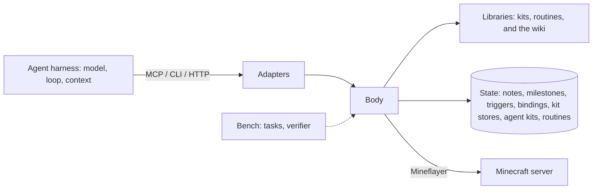

# The minebot SDK

The minebot SDK is the part of a Minecraft agent that is the same for every agent: a body in the game, the actions and observations of that body, and the state that belongs to it. An agent harness supplies the rest: the model, the turn loop, the context, and the decisions.

## Layers

| Layer | Contents | Who uses it |
| - | - | - |
| Body | The supervisor (API transport, event log, program history) and the bot host it forks (one Mineflayer player connection, the program runner, the body's state) | Every agent, through an adapter |
| Adapters | HTTP API, `minebot` CLI, MCP server | Harnesses |
| Libraries | Kits — built-in and agent-written — routines, and the wiki | Agents, when the body offers them |
| Bench | Harbor tasks, the verifier, the escape audit, launchers | People who evaluate agents |



One module map holds the boundaries: `src/protocol/` holds the wire contract (zod schemas for every request, the response types, the endpoint file, the capability table, and the TypeScript declarations derived from kit schemas) and, in `host.ts`, `request.ts`, and `event-filter.ts`, the contract between the supervisor and the bot host; `src/mc/` holds neutral Mineflayer helpers; `src/milestones/` is pure grading; `src/program/` runs programs; `src/kit/` is the kit framework and the kits; `src/routine/` is the routine surface (`minebot-sdk/routine`) and the call of a routine's default export; `src/body/` is the supervisor: the HTTP transport, the event log, the program history, and the code that forks, watches, and restarts the bot host; `src/host/` is the bot host: the Mineflayer connection, the body's state, the API routes, the triggers, the bindings, and the routine library and loader (`src/host/routines/`); `src/wiki/` serves pages; `src/client/` is the CLI, the MCP server, and the renderers. The client loads only the wire-contract part of `src/protocol/` (not `host.ts`, `request.ts`, or `event-filter.ts`) and what the protocol itself needs (`src/milestones/` and `src/mc/names.ts`) plus `src/package.ts`, which `minebot init` uses to find the package manifest. A test resolves the runtime import closure of the client and of the verifier, fails when either leaves its set, and checks that the image copy lists match it. Two more tests check that the supervisor loads no code from `src/host/`, `src/kit/`, `src/program/`, or `src/wiki/` and no Minecraft library, and that the bot host loads nothing from `src/body/`.

The npm package `minebot-sdk` is the authoring library plus the CLI; the body stays a separate runtime process that the CLI starts and that every other layer reaches over HTTP. Four entry points are public: `minebot-sdk/kit` (`src/kit/public.ts`, the one surface that built-in and agent kits write against), `minebot-sdk/routine` (`src/routine/public.ts`, the surface that a routine module writes against: `defineRoutine`, `RoutineContext`, and `z`), `minebot-sdk/client` (`src/client/public.ts`, the typed HTTP client and the wire types, with no CLI or MCP code), and `minebot-sdk/testing` (`src/testing/index.ts`, the kit and routine test harness). The package has no root export, so a bare `minebot-sdk` import does not resolve. Each export has a package-scoped `minebot-sdk:source` condition that resolves to the TypeScript under `src/`, and a default that resolves to the compiled `dist/`. The repository runs with `--conditions=minebot-sdk:source` and a published package without it, so a specifier such as `minebot-sdk/kit` means the same module in both. A test that resolves import closures follows these self-references to their `source` files. Kit sources (`src/kit/kits/`) and the wiki ship beside `dist/`, found through `PACKAGE_ROOT` (`src/package.ts`), so `kits source` and the default wiki directory work from either layout.

A body is two processes. The supervisor answers health, events, waits, and stop, and forwards every other request to the bot host, which holds the player connection and runs the programs. If the bot host crashes, or the supervisor kills it for a program that does not stop, the supervisor forks a replacement that reconnects as the same player. The restart waits 1 second; each restart in quick succession doubles the wait, up to 60 seconds, and a host that stays up for 60 seconds starts over at 1 second. A restart loses what the old host held in memory, such as `globalThis` and the running program; state on disk stays. The supervisor ends the lost program's run with an error that says the bot host was restarted.

The MCP server has two tool sets. `core`, the default, serves what an agent needs to act: `observe`, `run_program`, `stop_program`, `wait_for`, `get_events`, `api_reference`, `kit_docs`, `call_routine`, and `bind_routine`. Programs reach every other operation through their globals, except routines: a program cannot call or bind one, so `call_routine` and `bind_routine` are in the core set. The core set keeps the tool list small. `minebot mcp --tools full` also serves notes, status, chat, kit management, the wiki, triggers, and the routine library (`list_routines`, `routine_save`, `routine_source`, `routine_versions`, `routine_revert`, `unbind_routine`) as tools of their own. In both sets, the capability table decides which gated tools appear (`toolPlan` in `src/client/mcp.ts`): `kit_docs` needs kits, and the routine tools need routines. A tool description mentions reflexes only on a body that has triggers.

## The boundary between the SDK and a harness

Two rules decide where a feature belongs.

1. **If a feature acts without the agent asking, it belongs to the agent.** The body does not eat, flee, plan, retry, or give advice. The exceptions are things the connection requires: the body reconnects after a disconnect, it restarts a bot host that crashed, and it pauses after each inventory click so that crafting does not lose items. A trigger or a reflex is not an exception: the agent wrote its code, chose its events, and can remove it, so the body acts only because the agent registered it.
2. **If every harness needs a feature in the same form, it belongs to the SDK.** Observations, actions, events, and waits are the same for every harness. Context compaction, planning, todo lists, and restart loops differ between harnesses, so the harness supplies them.

State that must outlive a harness session belongs to the body. The body is the only part that persists when the context resets, the harness restarts, or the operator changes the harness. For this reason, notes, agent kits, triggers, routines, and bindings live on the body.

| In the SDK | In the harness |
| - | - |
| Observe, run programs, stop, chat | Choose the next action |
| Events and blocking waits | Decide when to wait and for what |
| Notes, milestones, kits, kit stores, triggers, routines, and bindings, on disk | What to keep in the context window |
| Status: deaths, reconnects | Plans and todo lists |
| Running the triggers and reflexes the agent registered | Which reflexes to install, and what they do |
| Reconnect, host restart, and click pacing | Restarts of the agent session |
| Kits and the wiki, when offered | Prompts and instructions |

## Kits

A kit is a composable library of typed actions. One authoring model covers the built-in kits and the kits agents write: every kit is a file that declares itself with `defineKit`, and every action with `action`.

```ts
import { action, defineKit, Point, z } from "minebot-sdk/kit";

export default defineKit(
  { name: "woodcutter", description: "Chops the nearest logs and reports where the player ends up.", uses: ["move", "sense", "dig"] },
  {
    chop: action({
      doc: "Walks to each of the `times` nearest logs within 16 blocks and digs it. Returns how many it dug and where the player then stands.",
      args: z.object({ times: z.number().int().positive().default(1) }),
      returns: z.object({ chopped: z.number(), standingAt: Point }),
      run: async (ctx, { times }) => {
        const logs = await ctx.kits.sense.find({ blocks: "*_log", radius: 16, count: times });
        for (const log of logs) {
          await ctx.kits.move.to({ position: log, range: 3 });
          await ctx.kits.dig.dig({ at: log });
        }
        const here = ctx.bot.entity.position.floored();
        return { chopped: logs.length, standingAt: { x: here.x, y: here.y, z: here.z } };
      },
    }),
  },
);
```

### Units

- **Action**: `action({ doc, args, returns, run })`. `args` is a zod object schema; `doc` says what the action does. Every action takes one object argument, validated on every call — nested calls included. A bad call fails with the action's schema in the error. `returns` is a zod schema of the result: `run` must return a value that fits it (checked by the type system), the result is validated on every call, and a mismatch fails the call naming `kit.<kit>.<action>` and the schema. Callers get the validated value, typed. Every built-in action declares `returns`.
- **Kit**: `defineKit({ name, description, uses }, actions)`. `uses` names the kits this kit calls; nothing else is reachable. It is the first argument, apart from the actions, so that `ctx.kits` in every action is typed from it.
- **`ctx`**: what `run` receives. It holds `bot`, `log`, `sleep`, `signal`, and `on` from the calling program (so cancellation propagates into nested actions), a time-limit helper `within`, the kits named in `uses` as `ctx.kits.<kit>.<action>({ ... })`, and `store` — persistent JSON scoped to this kit alone.

### Layers

Primitive kits do one thing. Routine kits are built only from public primitives through `ctx.kits`, so anything a routine kit does, an agent kit can do too, and combine differently. `surface` lives in `explorer` because it is a climb-to-open-sky routine built from `move` and `dig`.

| Primitive | Actions |
| - | - |
| `move` | `to`, `stop` |
| `sense` | `find`, `look` |
| `dig` | `dig` |
| `place` | `place` |
| `inventory` | `list`, `count`, `equip`, `toss` |
| `craft` | `craft`, `table` |
| `items` | `recipes`, `drops` |
| `furnace` | `smelt`, `take` |
| `container` | `list`, `deposit`, `withdraw` |
| `survival` | `eat`, `sleep`, `wake`, `armor` |
| `combat` | `attack`, `fight`, `retreat` |
| `farm` | `till`, `plant`, `harvest`, `breed` |
| `bucket` | `fill`, `empty` |

| Routine kit | Uses |
| - | - |
| `gatherer` | move, sense, dig, inventory, items |
| `crafter` | move, sense, place, inventory, craft, items, furnace |
| `builder` | move, sense, dig, place, inventory |
| `explorer` | move, sense, dig |
| `social` | move, sense, inventory |

The partition keeps each primitive small enough to learn from its source (`minebot kits source <kit>` prints it) and each routine honest about its dependencies. `inventory.count` and `items.drops` are separate because counting what you hold and finding what lies on the ground answer different questions; `craft` works at a table within reach while `crafter` is the routine that ensures a table exists; `furnace` smelts at a furnace within reach while `crafter` ensures one and smelts furnace outputs such as iron ingots.

### Namespaces and uses

Programs call actions as `kit.<kit>.<action>({ ... })`, so no two kits can collide on a name and every call says which kit it costs. Dependencies are explicit: a kit whose `uses` are not available fails when it is saved or loaded, never mid-run. Activating a kit activates the kits it uses.

### Offered and active

The operator decides which kits a body **offers** with `--kits <a,b>`; without the flag, every built-in kit is offered, plus saved agent kits. The agent picks the **active** set among the offered kits with `kits.use(...)`; a call to an offered but inactive kit names the kit to activate. `--lock-kits` fixes the active set: the other kits disappear from every surface, and a program finds no `kits.use`. On a locked body a saved kit is offered but not active; it joins the active set on the next start without the lock.

Docs come from the kits themselves: `kits.docs()` (and `minebot kits docs`) render each action's call shape, argument types and defaults, and return shape from its zod schemas, next to its `doc`.

Search and statistics help an agent choose. `kits.search(query, limit?)` ranks the kits and actions the body lists by name, kit description, and action doc (`minebot kits search`, `kit_search`, `GET /kits/search`). The ranker (`src/rank.ts`) is shared with the wiki search. A query word matches a word exactly, by prefix, or within one typo (both words 4 or more letters) or two (both 7 or more). Exact matches score as they would without fuzzy matching. A fuzzy match of a query word counts only in a document that lacks the word, scaled by its kind (prefix above typo). Documents with no exact match rank below every document with one. The framework counts every call of every action, nested calls included — returned, failed, and the message of the last failure — in `kit-stats.json` in the state directory. The counts are per body and survive restarts; `kits.available()` and `minebot kits` show them, so an agent prefers the actions that work.

### Agent kits

An agent saves a kit as TypeScript source: `kits.save(source)` in a program, `minebot kits save [file]` in the CLI, `kit_save { source }` over MCP, or `POST /kits/save` over HTTP. The source uses the shape above, with one import from `minebot-sdk/kit`: the body binds the named imports to the real module's values and injects nothing else. `import type` from any specifier is erased; every other import, `require`, `import()`, and `import.meta` is rejected, and so is the old form with `defineKit`, `action`, and `z` as globals (the error names the import line to add). The scan for these skips comments, strings, and templates, and `import()` is blocked again when the kit runs, so a spelling the scan misses still cannot load a module. The source exports exactly one kit: `export default defineKit(...)` or `export const <name> = defineKit(...)`, the form the built-ins use; other `export const` and `export function` declarations are ignored, so `kits.source("move")` can be saved under a new name unchanged. Types are stripped with node's own stripper; the body does not type-check a save, a workspace's `tsc` does (see Authoring workspace).

Saving validates before it writes, and writes atomically: the source must compile, pass the escape audit, use only kits this body offers, and not take a built-in kit's name. Nothing is written when the source is rejected. A saved kit is offered and active at once. `kits.remove(name)` deletes it; `kits.source(name)` prints any kit's source, starting point included.

Trying comes before saving. `kits.try(source, { action, args })` (`minebot kits try [file] --action <name> [--args <json>]`, `kit_try`, `POST /kits/try`) validates the source exactly like a save, then calls one action once against the live bot as part of the current program, and returns its result or throws its error. Nothing is written or registered, the `ctx.store` of the tried kit and of every kit it calls is thrown away, and no call is counted. Over MCP, CLI, and HTTP the try runs as a program, so it appears in the history like one.

Saving and trying type-check the source (`src/host/typecheck.ts`). The body writes the source and a `KitRegistry` block for its other agent kits (from their schemas, the same printer as `minebot types`) to a temporary directory, and runs the TypeScript compiler on it with the options of the `minebot init` workspace and `minebot-sdk/kit` mapped onto the package's own types. Only diagnostics in the kit's file count. The check never blocks: `kits.save` returns `typeCheck` (`passed`, `failed` with the errors, or `skipped` with a reason), and `kits.try` runs the check beside the action and writes failures to the program log. TypeScript is an optional peer dependency; without it the check reports `skipped`.

Saving over a kit keeps the old source as a numbered version: `.history/<kit>/<n>.ts` and `<n>.json` (`version`, `savedAt`, `savedBy` — the body's name) inside the agent-kit directory. A save of the source that is already saved adds no version. `kits.versions(name)` lists the versions and marks the current one; `kits.revert(name, version)` saves an earlier version again as a new version, validated like any save, so the history only grows. A removed kit keeps its history. Saving a different source for a kit, and removing it, resets that kit's counts, whichever body did it.

Several bodies may share the agent-kit directory (`--agent-kits <dir>`, default the state directory's `agent-kits/`); each re-reads it when it changes, so a kit one body saves works on the others without a restart, and the history is shared the same way: a version's number is claimed with an exclusive file create, so two bodies saving at once get different numbers. A bad file on disk never stops a body: it is skipped and reported as a `kit_error` event.

### Authoring workspace

`minebot init [dir]` scaffolds a workspace: `package.json` (dependency `minebot-sdk`, dev dependency `typescript`), a strict `tsconfig.json` that includes `kits/`, `programs/`, `test/`, and the generated declarations, an example kit, an example program, an example kit test (`test/hello.test.ts`, below), and a README. The body is not part of the workspace; it runs as a separate process with `--agent-kits ./kits`, so saving a kit file reloads it there.

`minebot types [--out <file>]` generates the declarations. It asks the body for the JSON Schema of every listed kit action (`GET /kits/schemas`, only on a body that offers kits, from zod 4's `toJSONSchema`: the argument as callers write it, the result as callers read it) and prints TypeScript for them. The file is a module with two parts: `declare module "minebot-sdk/kit" { interface KitRegistry { ... } }` for the kits the package does not ship, and `declare global { ... }` for the program globals. The globals follow the capability table (`CAPABILITY_GATES`): no `kit` or `kits` without kits, no `wiki.addLesson` without lessons, no `kits.use` on a locked body, and so on. `kit` is typed against `KitRegistry` for the active kits. Output is sorted and stable. A schema the printer cannot express becomes `unknown`.

Programs checked this way are `.ts` files: `minebot run file.ts` strips the types and sends JavaScript. They are function bodies, so they use top-level `await` (the tsconfig sets `moduleDetection: "force"`) and never a top-level `return`.

### Testing kits

`minebot-sdk/testing` (`src/testing/index.ts`) is the kit test harness. `createKitHarness({ kits, inventory, blocks, entities, position, time, ... })` builds the real `KitHost` around a fake Mineflayer bot, so an action runs through the same code as in a body: arguments and results are validated, `ctx.kits` offers only the kits in `uses`, each kit gets an in-memory store, and the active set applies. `h.call("kit.action", args)` runs one action; `h.kit` is the typed `kit` object a program sees; `h.calls` records every call, nested ones with the caller's arguments. `h.run(routine, args?)` runs a routine through `invokeRoutine`, the call the body makes, with the harness's bot, clock, kits, and in-memory notes. Each `h.run` is one run with a scope of its own: its own `ctx`, and its own `signal`, `sleep`, and `on`. The run's signal aborts when the call settles, so a later `ctx.sleep` rejects, and its `ctx.on` handlers hear events only until then. `h.abort()` aborts the `h.run` calls in progress, as a stop or a timeout does; with none in progress, it fires the signal that `h.call` and `h.kit` use. `ctx.status` and `ctx.wiki` throw `UnsupportedApiError` in `h.run`.

The bot is built on the registry that `prismarine-registry` loads for `MC_VERSION`, with real prismarine blocks, items, entities, and recipes. It implements a slice of Mineflayer on purpose: a block world over a ground layer (`blockAt`, `findBlock`, `findBlocks`, `dig` with drops, `placeBlock`), an inventory with Mineflayer's slot layout (`equip`, `toss`, crafting through the real recipes), entities and the day clock, furnaces that cook on the clock, and a pathfinder whose `goto` and `setGoal` teleport to the nearest standable spot that satisfies the goal. The harness tests decision logic, not physics. Every other Mineflayer member is wrapped so that calling it throws `UnsupportedApiError`: `not supported by minebot-sdk/testing: bot.attack`. A kit never continues with an `undefined` from an API the harness does not model, and a missing capability shows up as a named failure, not a wrong answer.

The harness imports the framework and the shipped kits from the package itself, so it ships in `dist/testing/` and runs the same from a checkout and from an installed package. The repository's own kit tests use it where they exercise a kit (`crafter.make` from seven logs, smelting, the framework's call, signal, and uses tests); helper-level tests of pure functions stay as they are.

## Triggers

A trigger is a program that the body runs when an event arrives. It gives an agent reflexes that act between its turns: eat when food is low, flee when hurt, answer a chat. The agent registers a trigger with `triggers.add({ name, on, run, ... })` in a program, `minebot triggers add <name> --on <types> [file]` in the CLI, `trigger_add` over MCP, or `POST /triggers` over HTTP.

- **Events.** `on` lists event types from the event log. The filters `from` and `match` work as in `wait`, and `when` is a JavaScript expression over `event` and `bot` that must be truthy. A trigger cannot listen to `trigger_*` events, so reflexes do not trigger each other.
- **The run.** `run` is a program with the usual globals plus `event`. It uses the same runner as every program, so one program runs at a time, and the run ends with a `trigger_finished` event, not `program_finished`.
- **Scheduling.** A firing waits until no program is running. It waits at most once per trigger, and waiting firings run by `priority`. A trigger with `preempt: true` stops the running program instead, unless that is a trigger of equal or higher priority. The firing runs when the stopped program has ended. `cooldownMs` limits how often a trigger fires.
- **Failure.** A failing trigger never affects the body. A trigger that errors or times out three times in a row disables itself and emits `trigger_disabled`; enabling it again clears the count.
- **State.** Triggers persist in the state directory as `triggers.json`, written atomically, so they survive a restart. A stored trigger that no longer loads is skipped and reported as a `trigger_error` event.
- **Audit.** The code of a trigger is checked with the escape audit like a program. The history records it when it is saved and records each firing with the trigger's name.

A body started with `--no-triggers` has no trigger routes, tools, commands, global, or wiki page, no reflexes, and a program reference that does not mention them.

## Routines

A routine is a TypeScript module that an agent saves on the body, and then calls by name or binds to events. A kit action is a typed function inside a framework of namespaces, `uses`, and per-kit stores; a routine is one ordinary ES module with one default-exported function.

- **The module.** The default export is `(ctx, args) => result`. `defineRoutine({ description?, args?, returns? }, fn)` (`src/routine/define.ts`) attaches the metadata to the function under `Symbol.for("minebot-sdk.routine")`, so a second copy of the package still reads it. `invokeRoutine` (`src/routine/invoke.ts`) is the one call: it replaces absent args with `{}`, parses declared `args` (defaults applied, a mismatch fails before the routine runs and names the schema), calls the function, and checks declared `returns`. A plain function gets its args unparsed.
- **The context.** `RoutineContext` (`src/routine/context.ts`) has `bot`, `log`, `sleep`, `signal`, `on`, `notes`, and `status`, and has `kit` when the body offers kits and `wiki` when the wiki is on: the gating of the program globals. It has no `kits` controller and no `triggers`, and `Vec3`, `goals`, and `Movements` are imports. `ctx.on`, `ctx.sleep`, and `ctx.signal` belong to the run and end with it. The timers and `bot.on` listeners that the routine creates itself are real and outlive the run; a leftover timer that throws after the run ended crashes the bot host, and the supervisor restarts it.
- **Loading.** Node strips the types and loads `<name>.ts` as an ES module, through `module.registerHooks` (`src/host/routines/loader.ts`). The loader resolves a bare specifier from the body package's root, so a routine finds the packages that the body ships and `minebot-sdk/<subpath>` wherever the library lives. A library module imports another by `./<name>.ts`; a relative import that leaves the library fails with an error that names the specifier. Each module URL carries a generation, a hash of the bytes of every module in the library. A save changes the generation, so the next call loads the changed graph; equal bytes give the same module instance, also after a revert. The bot host keeps old generations in memory until it restarts. No library operation loads a module: save, list, source, versions, revert, bind, and unbind never import one. Node does not strip types under `node_modules`, so the library must not live there.
- **Imports.** A routine uses `import`; `require` is not defined in an ES module, so a call that uses it fails. It may import Node built-ins, the packages that the body ships (`mineflayer`, `mineflayer-pathfinder`, `vec3`, `minecraft-data`, `prismarine-*`, `zod`), `minebot-sdk/<subpath>`, and other library modules as `./<name>.ts`. A bare `minebot-sdk` does not resolve, because the package has no root export. A relative import names the `.ts` file; the type check does not catch a `.js` name for a `.ts` file, and the call fails with `Cannot find module`. When an agent saves several routines, it lists the imported modules first (`minebot routines save helper.ts act.ts`), because the type check of a routine runs at its save and reports `TS2307` for a module that is not saved yet. Node versions before 24.3 print a type-stripping warning when a routine loads.
- **The library.** `RoutineLibrary` (`src/host/routines/library.ts`) keeps a flat directory of `<name>.ts` files with the history in `.history/<name>/<n>.ts` and `<n>.json`, as the agent-kit library does. A name matches `^[a-z][a-z0-9_-]{0,47}$` and a source has at most 128 KiB; both are checked before anything is written. A version number is claimed with an exclusive file create, so two bodies that share the directory get different numbers. A file whose bytes are in no version is recorded as a version saved by `unknown` before a save or revert writes over it, so a hand edit is never lost. Saving the source that is already current adds no version.
- **The type check.** `typeCheckRoutine` (`src/host/typecheck.ts`) copies the library's modules into a temporary project and links the packages that Node finds from the package's own location. It uses strict options that make the check match the loader: `erasableSyntaxOnly` and `verbatimModuleSyntax`, with a module package scope. Only diagnostics in the saved file count, and the check never blocks a save. TypeScript is an optional peer dependency; without it the check is `skipped`. The check finds `@types/node` where a hoisted install puts it: with `--install-strategy=nested` it is missing, and imports of Node built-ins fail with TS2591. The check does not catch a relative `.js` import of a `.ts` file, which fails when the routine loads.
- **Bindings.** `Bindings` (`src/host/bindings.ts`) names saved routines. An action is an entry in `bindings.json`. A reflex is a trigger definition whose body is a routine, stored in `triggers.json`, so it shares the trigger scheduler, priorities, preemption, cooldown, limit of 50, and self-disable after 3 failures. An action, a reflex, and a code trigger share one namespace: a clash is refused with HTTP 409. A stored action whose name a trigger definition also holds is skipped at load, kept in the file, and reported as a `binding_error` event. Binding a reflex again replaces it, resets its counts, and enables it; there is no enable route. A bind checks that the routine exists and does not load it. The `/triggers` routes and the `triggers` global see code triggers only.
- **Runs.** A call and a reflex firing run through the same runner as a program, so one run goes at a time and the same timeout, stop, and kill deadline apply. The body does for a call what it does for `run`: it syncs the kits, pushes `program_finished`, and starts the waiting firings. A reflex firing ends with `trigger_finished`. The reflex's routine gets `(ctx, { event })`, and the event is `{ seq, type, time, data }`. The history records a call with an empty `code` and `call: { name, routine, args }`, and a firing with `trigger`, `routine`, and `event`.
- **Calls.** A call is a run of the action bound to the name. `POST /call` answers a name that no action holds with HTTP 404, and a call that arrives while another run goes with HTTP 409. The default timeout is 60 seconds and the maximum is 30 minutes. A stop, a timeout, or a preemption aborts the run, and the kill deadline ends the bot host 5.5 seconds after the abort if the routine has not ended, also when it blocks the host with synchronous code.
- **Surfaces.** HTTP: `GET /routines`, `GET /routines/source?name=`, `POST /routines/save`, `GET /routines/versions?name=`, `POST /routines/revert`, `GET /bindings`, `POST /bind`, `POST /unbind`, and `POST /call`. CLI: `minebot routines [save <file...> | source <name> | versions <name> | revert <name> <version>]`, `minebot bind action <name> <routine>`, `minebot bind reflex <name> <routine> --on <types>`, `minebot unbind <name>`, and `minebot call <name> [--args <json>] [--timeout <ms>]`. MCP: `call_routine` and `bind_routine` in the core set; `list_routines`, `routine_save`, `routine_source`, `routine_versions`, `routine_revert`, and `unbind_routine` in the full set. The MCP tools take `timeout_ms` and `cooldown_ms`; HTTP takes `timeoutMs` and `cooldownMs`. The routine tools exist on a body that offers routines, and the reflex fields of `bind_routine` and the reflex wording of the other descriptions exist on a body that also has triggers.
- **No audit.** A routine is a real module with the whole Node API, so the escape audit does not scan it and the history line of a call has an empty `escapeAttempts`. `--no-routines` removes the feature.

The body offers routines unless it starts with `--no-routines`; `--routines <dir>` picks the directory (default `routines/` in the state directory), and `--routines ""` turns routines off. A reflex needs routines and triggers both. A body without routines has no routine routes, tools, commands, or program-reference section, and no reflexes.

## Primitives

| Primitive | What it does |
| - | - |
| Observe | Returns the player's state as JSON, or as one line with `--brief`. |
| Run | Runs a JavaScript program against the live bot and returns logs and a result. |
| Stop | Aborts the running program and halts movement and digging. |
| Events | Returns chat, damage, deaths, joins, disconnects, day and night changes, finished programs, and what the player did or noticed (items picked up, blocks broken or placed, items crafted, hostile creatures near, low health or food) since a cursor. |
| Wait | Blocks until an event matches a filter, or until a timeout. An agent uses it to idle at the cost of one call. |
| Chat | Sends a chat message as the player. |
| Notes | Stores text that the agent writes, on the body. |
| Agent kits | Stores typed kits that the agent writes, on the body. Programs call them as `kit.<kit>.<action>({ ... })`. |
| Triggers | Stores programs that the agent writes, on the body, and runs each one when an event of its kind arrives. |
| Routines | Stores TypeScript modules that the agent writes, on the body. The agent calls one by name, or binds it to events as a reflex. |
| Status | Returns deaths and reconnects since the body started. |

## Features

Each body offers a set of features. The operator chooses the set when the body starts. One capability table derives every agent-facing surface — the CLI help, `minebot api`, the MCP tool list and descriptions, the program globals, the API routes, the wiki pages, and the observation — so an agent never learns about a feature that its body does not offer.

| Feature | Body option | Default |
| - | - | - |
| Kits | `--kits <a,b>`, `--lock-kits` | every built-in kit offered |
| Agent kits | `--no-agent-kits`, `--agent-kits <dir>` | on |
| Wiki | `--wiki off\|read\|write` | read |
| Milestones | `--milestones <file>`, `--no-milestones` | on |
| Triggers | `--no-triggers` | on |
| Routines | `--no-routines`, `--routines <dir>` | on |

The benchmark starts every body with `--no-agent-kits` and `--no-milestones`, with `--no-triggers` except in `survive-nights`, and selects kits and the wiki per tier. See [bench/README.md](../bench/README.md).

## Run an agent for a long time

The SDK does not include a loop that restarts the agent. To run an agent for days, run the harness in a loop that you control. Start each session with a prompt that tells the agent to read its notes, its status, and the events since its last session. The body keeps the notes, the milestones, the kit stores, and the agent kits between sessions.
