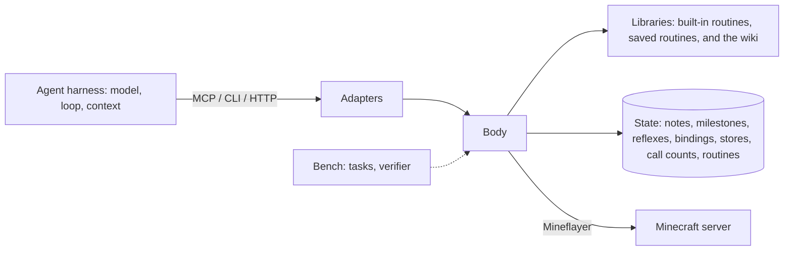

# The minebot SDK

The minebot SDK is the part of a Minecraft agent that is the same for every agent: a body in the game, the actions and observations of that body, and the state that belongs to it. An agent harness supplies the rest: the model, the turn loop, the context, and the decisions.

If you used an earlier version with kits, triggers, or programs, read [Migrating from kits, triggers and programs](../README.md#migrating-from-kits-triggers-and-programs).

## Layers

| Layer | Contents | Who uses it |
| - | - | - |
| Body | The supervisor (API transport, event log, run history) and the bot host it forks (one Mineflayer player connection, the run loader, the body's state) | Every agent, through an adapter |
| Adapters | HTTP API, `minebot` CLI, MCP server | Harnesses |
| Libraries | Built-in routines, saved routines, and the wiki | Agents, when the body offers them |
| Bench | Harbor tasks, the verifier, the escape audit, launchers | People who evaluate agents |

One module map holds the boundaries: `src/protocol/` holds the wire contract (zod schemas for every request, the response types, the endpoint file, the capability table, and the compiler options of the routine type check) and, in `host.ts`, `request.ts`, and `event-filter.ts`, the contract between the supervisor and the bot host; `src/mc/` holds neutral Mineflayer helpers; `src/milestones/` is pure grading; `src/program/` holds the run slot: the call lifecycle of a run, a call, and a reflex firing; `src/routine/` is the routine surface (`minebot-sdk/routine`) and the call of a routine's default export; `src/routines/` holds the built-in routine modules; `src/body/` is the supervisor: the HTTP transport, the event log, the run history, and the code that forks, watches, and restarts the bot host; `src/host/` is the bot host: the Mineflayer connection, the body's state, the API routes, the reflexes, the bindings, and the routine library, the built-in routines, and the loader (`src/host/routines/`); `src/wiki/` serves pages; `src/client/` is the CLI, the MCP server, and the renderers. The client loads only the wire-contract part of `src/protocol/` (not `host.ts`, `request.ts`, or `event-filter.ts`) and what the protocol itself needs (`src/milestones/` and `src/mc/names.ts`) plus `src/package.ts`, which `minebot init` uses to find the package manifest. A test resolves the runtime import closure of the client and of the verifier, fails when either leaves its set, and checks that the image copy lists match it. Two more tests check that the supervisor loads no code from `src/host/`, `src/routines/`, `src/program/`, or `src/wiki/` and no Minecraft library, and that the bot host loads nothing from `src/body/`.

The npm package `minebot-sdk` is the authoring library plus the CLI; the body stays a separate runtime process that the CLI starts and that every other layer reaches over HTTP. The package exports these subpaths: `minebot-sdk/routine` (`src/routine/public.ts`, the surface that a routine module writes against: `defineRoutine`, `RoutineContext`, `z`, and the helpers that the built-in routines use), `minebot-sdk/routines/<module>` (`src/routines/<module>.ts`, one built-in module each), `minebot-sdk/client` (`src/client/public.ts`, the typed HTTP client and the wire types, with no CLI or MCP code), and `minebot-sdk/testing` (`src/testing/index.ts`, the routine test harness). The package has no root export, so a bare `minebot-sdk` import does not resolve, and `minebot-sdk/routines/index`, the catalog of the modules, is not exported. Each export has a package-scoped `minebot-sdk:source` condition that resolves to the TypeScript under `src/`, and a default that resolves to the compiled `dist/`. The repository runs with `--conditions=minebot-sdk:source` and an installed package without it, so a specifier such as `minebot-sdk/routine` means the same module in both. A test that resolves import closures follows these self-references to their `source` files. The built-in routine sources (`src/routines/`) and the wiki ship beside `dist/`, found through `PACKAGE_ROOT` (`src/package.ts`), so `builtins source` and the default wiki directory work from either layout. While the package is unpublished, install it from a checkout: see [Install](../README.md#install).

A body is two processes. The supervisor answers health, events, waits, and stop, and forwards every other request to the bot host, which holds the player connection and runs the modules. If the bot host crashes, or the supervisor kills it for a run that does not stop, the supervisor forks a replacement that reconnects as the same player. The restart waits 1 second; each restart in quick succession doubles the wait, up to 60 seconds, and a host that stays up for 60 seconds starts over at 1 second. A restart loses what the old host held in memory, such as `globalThis` and the running run; state on disk stays. The supervisor ends the lost run with an error that says the bot host was restarted.

The MCP server has two tool sets. `core`, the default, serves what an agent needs to act: `observe`, `run_program`, `stop_program`, `wait_for`, `get_events`, `api_reference`, `builtin_docs`, `call_routine`, and `bind_routine`. A run reaches every other operation through `ctx`, except routines: a run cannot bind one, so `call_routine` and `bind_routine` are in the core set, and `builtin_docs` documents what a call can name. The core set keeps the tool list small. `minebot mcp --tools full` also serves notes, status, chat, the other built-in tools (`list_builtins`, `builtin_search`, `builtin_source`), the wiki, and the routine library (`list_routines`, `routine_save`, `routine_source`, `routine_versions`, `routine_revert`, `unbind_routine`) as tools of their own. In both sets, the capability table decides which gated tools appear (`toolPlan` in `src/client/mcp.ts`): the built-in tools need built-ins, `call_routine` needs routines or built-ins, and the routine tools need routines. A tool description mentions reflexes only on a body that has reflexes.

## The boundary between the SDK and a harness

Two rules decide where a feature belongs.

1. **If a feature acts without the agent asking, it belongs to the agent.** The body does not eat, flee, plan, retry, or give advice. The exceptions are things the connection requires: the body reconnects after a disconnect, it restarts a bot host that crashed, and it pauses after each inventory click so that crafting does not lose items. A reflex is not an exception: the agent chose its routine and its events and can remove it, so the body acts only because the agent bound it.
2. **If every harness needs a feature in the same form, it belongs to the SDK.** Observations, actions, events, and waits are the same for every harness. Context compaction, planning, todo lists, and restart loops differ between harnesses, so the harness supplies them.

State that must outlive a harness session belongs to the body. The body is the only part that persists when the context resets, the harness restarts, or the operator changes the harness. For this reason, notes, routines, bindings, reflexes, and stores live on the body.

| In the SDK | In the harness |
| - | - |
| Observe, run modules, stop, chat | Choose the next action |
| Events and blocking waits | Decide when to wait and for what |
| Notes, milestones, routines, bindings, reflexes, and stores, on disk | What to keep in the context window |
| Status: deaths, reconnects | Plans and todo lists |
| Running the reflexes the agent bound | Which reflexes to install, and what they do |
| Reconnect, host restart, and click pacing | Restarts of the agent session |
| Built-in routines and the wiki, when offered | Prompts and instructions |

## Runs

A run is a TypeScript or JavaScript module that the body evaluates inside the bot host, against the live bot, afresh each time. `POST /run` takes `{ code, args?, timeoutMs? }`; `minebot run [file]` and `run_program` send the same.

- **Result.** The result is the default export. A function is called with `(ctx, args)` and its awaited return is the result; any other default export is the result itself, awaited; a module without a default export has no result. `args` is the JSON object of the request, and `{}` when none. A `return` statement outside a function is a syntax error, so a run cannot end with one.
- **Loading.** The loader (`src/host/routines/loader.ts`) registers resolve and load hooks with `module.registerHooks`, once per process. A run is a module of its own, kept apart from the library under `<dir>/.run.ts` with a query of its own, so it never changes a library generation. Its imports resolve as a library module's do: `./<name>.ts` is the library's module of that name at the library's generation when the run starts, and any other path or `file:` URL is refused. Packages, Node built-ins, and `data:` URLs import as Node would. A body without a library has runs too, which import packages and Node built-ins only.
- **`ctx`.** The run's context is the routine context, below.
- **Slot.** A run, a call, and a reflex firing share one slot. One goes at a time; a second request gets HTTP 409. The default timeout is 60 seconds and the maximum is 30 minutes. A stop, a timeout, or a preemption aborts the run, and the kill deadline ends the bot host 5.5 seconds after the abort if the run has not ended, also when it blocks the host with synchronous code.
- **History.** With `--history`, the body records each run as a JSON line: `code`, status, logs, result, duration, `escapeAttempts`, and `args` when the run got some. The history scans the source of a run with the escape audit (`src/audit.ts`) and writes a flagged run before it runs.

## Built-in routines

The kits of earlier versions are now built-in routines. Each routine is shipped by the package in a module under `src/routines/`. A module is a file with two exports that describe it, `description` and `uses` (the built-in modules it calls), and one `defineRoutine` export per routine. `minebot builtins source <module>` prints a module, such as `minebot builtins source gatherer`.

### Units

- **Routine.** `defineRoutine({ name?, description?, args?, returns? }, fn)` returns a function `(ctx, args?) => Promise<result>`. `args` and `returns` are zod schemas. Every call of it validates: the arguments (an omitted argument is `{}`, and `null` is an argument), then the result. A bad call fails with the routine's name and the schema. A built-in routine declares `name` as `<module>.<routine>`.
- **Module.** `description`, `uses` (the built-in modules it calls), and its routines. A module imports only `minebot-sdk/routine` and the modules it lists in `uses`; a test checks this.
- **`ctx`.** What a routine receives: `bot`, `log`, `sleep`, `signal`, `on`, `notes`, `status`, `store`, and `wiki` when the wiki is on. A routine that calls another passes its own `ctx` on, so cancellation reaches every nested call.

### Layers

Primitive modules do one thing. The routine modules `gatherer`, `crafter`, `builder`, `explorer`, and `social` are built only from the public routines of other modules, so anything they do, your own routine can do too, and combine differently. `surface` lives in `explorer` because it is a climb-to-open-sky routine built from `move` and `dig`.

| Primitive | Routines |
| - | - |
| `move` | `to`, `stop` |
| `sense` | `find`, `look` |
| `dig` | `dig` |
| `place` | `place` |
| `inventory` | `list`, `count`, `equip`, `toss` |
| `craft` | `craft`, `table` |
| `items` | `recipes`, `drops` |
| `furnace` | `smelt`, `take` |
| `container` | `list`, `deposit`, `withdraw` |
| `survival` | `eat`, `sleep`, `wake`, `armor` |
| `combat` | `attack`, `fight`, `retreat` |
| `farm` | `till`, `plant`, `harvest`, `breed` |
| `bucket` | `fill`, `empty` |

| Routine module | Uses |
| - | - |
| `gatherer` | move, sense, dig, inventory, items |
| `crafter` | move, sense, place, inventory, craft, items, furnace |
| `builder` | move, sense, dig, place, inventory |
| `explorer` | move, sense, dig |
| `social` | move, sense, inventory |

The partition keeps each primitive small enough to learn from its source (`minebot builtins source <module>` prints it) and each routine module honest about its dependencies. `inventory.count` and `items.drops` are separate because counting what you hold and finding what lies on the ground answer different questions; `craft` works at a table within reach while `crafter` is the routine that ensures a table exists; `furnace` smelts at a furnace within reach while `crafter` ensures one and smelts furnace outputs such as iron ingots.

### Call names and imports

A built-in routine has the call name `<module>.<routine>`: `POST /call`, `minebot call`, and `call_routine` take it with no binding. A name with a dot is never a binding. A routine or a run imports the module (`import * as move from "minebot-sdk/routines/move"`) and calls `move.to(ctx, { ... })`; the call validates as any call of a routine does.

### Offered built-ins

The operator decides which built-in modules a body **offers** with `--builtins <a,b|none>`. Without the flag, every module is offered. With names, the body offers them and every module they use: `Builtins` (`src/host/routines/builtins.ts`) takes the closure over `uses`. `none` offers none, and an unknown name stops the start. A module that is not offered is absent from the list, the reference, the search, the source, and `/call`. The loader enforces the same offer: a library module or a run that imports `minebot-sdk/routines/<module>` for a module the body does not offer fails (`setOfferGate`). There is no active set.

### Docs, search, and statistics

Docs, search, and source come from the routines' metadata, which the body knows without running agent code: the catalog (`src/routines/index.ts`) lists each module's routines in declaration order. `builtins docs` (`GET /builtins/docs`, `builtin_docs`) renders each routine's call shape, argument types and defaults, and return shape from its zod schemas, next to its description.

Search and statistics help an agent choose. `minebot builtins search <query>` (`GET /builtins/search`, `builtin_search`) ranks the offered modules and routines by name, description, and argument names. The ranker (`src/rank.ts`) is shared with the wiki search. A query word matches a word exactly, by prefix, or within one typo (both words 4 or more letters) or two (both 7 or more). Exact matches score as they would without fuzzy matching. A fuzzy match of a query word counts only in a document that lacks the word, scaled by its kind (prefix above typo). Documents with no exact match rank below every document with one. A call observer counts every call of every offered built-in routine, nested calls included: returned, failed, and the message of the last failure. A call that fails after the run was aborted is not counted. One writer, `KitStats` (`src/host/routines/stats.ts`), keeps the counts in `kit-stats.json` in the state directory, so they survive restarts, and `minebot builtins` and `GET /builtins` report them.

## Authoring workspace

`minebot init [dir]` scaffolds a workspace: `package.json` (dependency `minebot-sdk`, dev dependencies `typescript` and `@types/node`), a strict `tsconfig.json` with the options of the body's routine type check and `rootDirs` for `routines` and `runs`, an example routine (`routines/hello.ts`, which calls `inventory.count`), an example run (`runs/say-hello.ts`), an example routine test (`test/hello.test.ts`, below), and a README. The body is not part of the workspace; it runs as a separate process, and `minebot routines save routines/*.ts` saves the routines into its library. `init` never overwrites a file that exists, so it does not upgrade an old workspace.

Runs and routines are `.ts` files that `tsc` checks. `minebot run file.ts` sends the file as it is, and the body strips the types. A run is a module, so it uses top-level `await` and `export default`. The tsconfig sets `moduleDetection: "force"`.

## Testing routines

`minebot-sdk/testing` (`src/testing/index.ts`) is the routine test harness. `createHarness({ inventory, blocks, entities, position, time, ... })` builds a fake Mineflayer bot, and `h.run(routine, args?)` runs a routine through `invokeRoutine`, the call the body makes, with the harness's bot, clock, and in-memory notes and `ctx.store` namespaces. Each `h.run` is one run with a scope of its own: its `ctx.signal` aborts when the call settles, a later `ctx.sleep` rejects, and its `ctx.on` handlers hear events only until then. A value set through `ctx.store(namespace)` in one run is read in the next, as in the body. `ctx.status` and `ctx.wiki` throw `UnsupportedApiError`, because the harness has no body to ask.

`h.calls` records the calls of routine values that are declared with a `module.routine` name, which are the built-in routines, nested calls included, with the caller's arguments. Each record is `{ kit, action, args }`: the module, the routine, and the arguments. A routine value without such a name is not recorded.

The bot is built on the registry that `prismarine-registry` loads for `MC_VERSION`, with real prismarine blocks, items, entities, and recipes. It implements a slice of Mineflayer on purpose: a block world over a ground layer (`blockAt`, `findBlock`, `findBlocks`, `dig` with drops, `placeBlock`), an inventory with Mineflayer's slot layout (`equip`, `toss`, crafting through the real recipes), entities and the day clock, furnaces that cook on the clock, and a pathfinder whose `goto` and `setGoal` teleport to the nearest standable spot that satisfies the goal. The harness tests decision logic, not physics. Every other Mineflayer member is wrapped so that calling it throws `UnsupportedApiError`: `not supported by minebot-sdk/testing: bot.attack`.

The harness imports the routine contract from the package itself, so it ships in `dist/testing/` and runs the same from a checkout and from an installed package. The repository's own tests use it where they exercise a built-in routine (`crafter.make` from seven logs, smelting); helper-level tests of pure functions stay as they are.

## Routines

A routine is a TypeScript module that an agent saves on the body, and then calls by name or binds to events. A routine is one ordinary ES module with one default-exported function; the built-in routines use the same `defineRoutine`.

- **The module.** The default export is `(ctx, args) => result`. `defineRoutine({ description?, args?, returns? }, fn)` (`src/routine/define.ts`) attaches the metadata to the function under `Symbol.for("minebot-sdk.routine")`, so a second copy of the package still reads it. `invokeRoutine` (`src/routine/invoke.ts`) is the one call: it replaces absent args with `{}`, parses declared `args` (defaults applied, a mismatch fails before the routine runs and names the schema), calls the function, and checks declared `returns`. A plain function gets its args unparsed.
- **The context.** `RoutineContext` (`src/routine/context.ts`) has `bot`, `log`, `sleep`, `signal`, `on`, `notes`, `status`, and `store`, and has `wiki` when the wiki is on. It has no other optional member, and `Vec3`, `goals`, and `Movements` are imports. `store(namespace)` is a JSON store in `<state>/stores/<namespace>.json`: a namespace is a routine name that is not `notes` or `body`, every run that opens it shares it, and it survives restarts. `ctx.on`, `ctx.sleep`, and `ctx.signal` belong to the run and end with it. The timers and `bot.on` listeners that the routine creates itself are real and outlive the run; a leftover timer that throws after the run ended crashes the bot host, and the supervisor restarts it.
- **Loading.** Node strips the types and loads `<name>.ts` as an ES module, through `module.registerHooks` (`src/host/routines/loader.ts`). The loader resolves a bare specifier from the body package's root, so a routine finds the packages that the body ships and `minebot-sdk/<subpath>` wherever the library lives. A library module imports another by `./<name>.ts`; a relative import that leaves the library fails with an error that names the specifier. Each module URL carries a generation, a hash of the bytes of every module in the library. A save changes the generation, so the next call loads the changed graph; equal bytes give the same module instance, also after a revert. The bot host keeps old generations in memory until it restarts. No library operation loads a module: save, list, source, versions, revert, bind, and unbind never import one. Node does not strip types under `node_modules`, so the library must not live there.
- **Imports.** A routine may import Node built-ins, the packages that the body ships (`mineflayer`, `mineflayer-pathfinder`, `vec3`, `minecraft-data`, `prismarine-*`, `zod`), `minebot-sdk/<subpath>`, and other library modules as `./<name>.ts`. A package that is CommonJS imports by name (`import { goals } from "mineflayer-pathfinder"`): the loader fronts it with a facade whose default export is the body's own instance. `require` is bound to a `createRequire` anchored where the module's bare specifiers resolve, unless the module has a binding of that name of its own. A bare `minebot-sdk` does not resolve, because the package has no root export. A relative import names the `.ts` file; the type check does not catch a `.js` name for a `.ts` file, and the call fails with `Cannot find module`. When an agent saves several routines, it lists the imported modules first (`minebot routines save helper.ts act.ts`), because the type check of a routine runs at its save and reports `TS2307` for a module that is not saved yet. Node versions before 24.3 print a type-stripping warning when a routine loads.
- **The library.** `RoutineLibrary` (`src/host/routines/library.ts`) keeps a flat directory of `<name>.ts` files with the history in `.history/<name>/<n>.ts` and `<n>.json`. A name matches `^[a-z][a-z0-9_-]{0,47}$` and a source has at most 128 KiB; both are checked before anything is written. A version number is claimed with an exclusive file create, so two bodies that share the directory get different numbers. A file whose bytes are in no version is recorded as a version saved by `unknown` before a save or revert writes over it, so a hand edit is never lost. Saving the source that is already current adds no version.
- **The type check.** `typeCheckRoutine` (`src/host/typecheck.ts`) copies the library's modules into a temporary project and links the packages that Node finds from the package's own location. It uses the strict options that make the check match the loader (`ROUTINE_COMPILER_OPTIONS` in `src/protocol/routine-tsconfig.ts`): `erasableSyntaxOnly` and `verbatimModuleSyntax`, with a module package scope. Only diagnostics in the saved file count, and the check never blocks a save. TypeScript is an optional peer dependency; without it the check is `skipped`. The check finds `@types/node` where a hoisted install puts it: with `--install-strategy=nested` it is missing, and imports of Node built-ins fail with TS2591. The check does not catch a relative `.js` import of a `.ts` file, which fails when the routine loads.
- **Bindings.** `Bindings` (`src/host/bindings.ts`) names saved routines. An action is an entry in `bindings.json`. A reflex is an entry in the reflexes' store, so it shares their scheduler, priorities, preemption, cooldown, limit of 50, and self-disable after 3 failures. An action and a reflex share one namespace: a clash is refused with HTTP 409. A stored action whose name a reflex or a skipped entry also holds is skipped at load, kept in the file, and reported as a `binding_error` event; it becomes callable after the other entry is unbound and the body restarts. Binding a reflex again replaces it, resets its counts, and enables it; there is no enable route. A bind checks that the routine exists and does not load it.
- **Runs.** A call and a reflex firing run through the same slot as a run, so one goes at a time and the same timeout, stop, and kill deadline apply. The body does for a call what it does for `run`: it pushes `program_finished` and starts the waiting firings. A reflex firing ends with `reflex_finished`. The reflex's routine gets `(ctx, { event })`, and the event is `{ seq, type, time, data }`. The history records a call with an empty `code` and `call: { name, routine, args }` (`{ name, args }` for a built-in), and a firing with `trigger`, `routine`, and `event`.
- **Calls.** A call is a run of the action bound to the name, or of the built-in routine that the name `<module>.<routine>` gives. `POST /call` answers a name that no action holds and no offered built-in matches with HTTP 404, and a call that arrives while another run goes with HTTP 409. The default timeout is 60 seconds and the maximum is 30 minutes. A stop, a timeout, or a preemption aborts the run, and the kill deadline ends the bot host 5.5 seconds after the abort if the routine has not ended, also when it blocks the host with synchronous code.
- **Surfaces.** HTTP: `GET /routines`, `GET /routines/source?name=`, `POST /routines/save`, `GET /routines/versions?name=`, `POST /routines/revert`, `GET /bindings`, `POST /bind`, `POST /unbind`, and `POST /call`. CLI: `minebot routines [save <file...> | source <name> | versions <name> | revert <name> <version>]`, `minebot bind action <name> <routine>`, `minebot bind reflex <name> <routine> --on <types>`, `minebot unbind <name>`, and `minebot call <name> [--args <json>] [--timeout <ms>]`. MCP: `call_routine` and `bind_routine` in the core set; `list_routines`, `routine_save`, `routine_source`, `routine_versions`, `routine_revert`, and `unbind_routine` in the full set. The MCP tools take `timeout_ms` and `cooldown_ms`; HTTP takes `timeoutMs` and `cooldownMs`. The routine tools exist on a body that offers routines, and the reflex fields of `bind_routine` and the reflex wording of the other descriptions exist on a body that also has reflexes.
- **No audit of saved routines.** A routine is a real module with the whole Node API, so the escape audit does not scan it, and the history line of a call has an empty `escapeAttempts`. `--no-routines` removes the feature.

The body offers routines unless it starts with `--no-routines`; `--routines <dir>` picks the directory (default `routines/` in the state directory), and `--routines ""` turns routines off. A reflex needs routines and reflexes both. A body without routines has no routine routes, tools, commands, or run-reference section, and no reflexes. Built-in routines are called by name wherever the body offers them, with or without routines.

## Reflexes

A reflex is a routine that the body calls when an event arrives. It gives an agent reflexes that act between its turns: eat when food is low, flee when hurt, answer a chat. The agent binds a reflex with `minebot bind reflex <name> <routine> --on <types>`, `bind_routine`, or `POST /bind`.

- **Events.** `on` lists event types from the event log. The filters `from` and `match` work as in `wait`, and `when` is a JavaScript expression over `event` and `bot` that must be truthy. A reflex cannot listen to `reflex_*` events, so reflexes do not trigger each other.
- **The run.** The routine is called as `(ctx, { event })`. It uses the same slot as every run, so one goes at a time, and the run ends with a `reflex_finished` event, not `program_finished`.
- **Scheduling.** A firing waits until no run is going. It waits at most once per reflex, and waiting firings run by `priority`. A reflex with `preempt: true` stops the running run instead, unless that is a reflex of equal or higher priority. The firing runs when the stopped run has ended. `cooldownMs` limits how often a reflex fires.
- **Failure.** A failing reflex never affects the body. A reflex that errors or times out three times in a row disables itself and emits `reflex_disabled`; binding it again clears the count.
- **State.** Reflexes persist in the state directory, written atomically, so they survive a restart. A stored entry that no longer loads as a reflex, such as a code trigger from an earlier version, is skipped, reported as a `reflex_error` event, kept in the file, and holds its name until `unbind` removes it. [Migrating from kits, triggers and programs](../README.md#migrating-from-kits-triggers-and-programs) tells an operator what to do.
- **Audit.** The history records a bind (its `when` expression is the `code`, with the audit over it) and each firing with the reflex's name.

A body started with `--no-reflexes` has no reflexes: no reflex fields in the tools, no `bind reflex`, and a run reference that does not mention them.

## Operations

| Operation | What it does |
| - | - |
| Observe | Returns the player's state as JSON, or as one line with `--brief`. |
| Run | Runs a module against the live bot and returns logs and a result. |
| Stop | Aborts the running run and halts movement and digging. |
| Events | Returns chat, damage, deaths, joins, disconnects, day and night changes, finished runs, and what the player did or noticed (items picked up, blocks broken or placed, items crafted, hostile creatures near, low health or food) since a cursor. |
| Wait | Blocks until an event matches a filter, or until a timeout. An agent uses it to idle at the cost of one call. |
| Chat | Sends a chat message as the player. |
| Notes | Stores text that the agent writes, on the body. |
| Built-in routines | Runs the routines that the package ships, by name or by import. |
| Routines | Stores TypeScript modules that the agent writes, on the body. The agent calls one by name, or binds it to events as a reflex. |
| Status | Returns deaths and reconnects since the body started. |

## Features

Each body offers a set of features. The operator chooses the set when the body starts. One capability table (`CAPABILITY_GATES` in `src/protocol/features.ts`) derives every agent-facing surface — the CLI help, `minebot api`, the MCP tool list and descriptions, the run context, the API routes, the wiki pages, and the observation — so an agent never learns about a feature that its body does not offer. The capabilities are `wiki`, `lessons`, `milestones`, `reflexes`, `routines`, `builtins`, and `call`. `call` is on when the body has routines or built-ins.

| Feature | Body option | Default |
| - | - | - |
| Built-in routines | `--builtins <a,b\|none>` | every module offered |
| Wiki | `--wiki off\|read\|write` | read |
| Milestones | `--milestones <file>`, `--no-milestones` | on |
| Reflexes | `--no-reflexes` | on |
| Routines | `--no-routines`, `--routines <dir>` | on |

The benchmark in `bench/` has its own setup. See [bench/README.md](../bench/README.md).

## Run an agent for a long time

The SDK does not include a loop that restarts the agent. To run an agent for days, run the harness in a loop that you control. Start each session with a prompt that tells the agent to read its notes, its status, and the events since its last session. The body keeps the notes, the milestones, the stores, the routines, and the reflexes between sessions.
