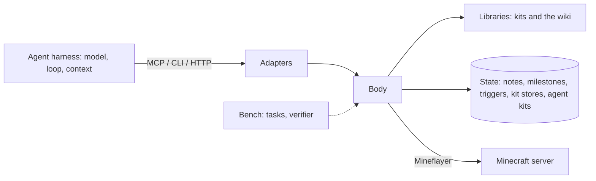

# The minebot SDK

The minebot SDK is the part of a Minecraft agent that is the same for every agent: a body in the game, the actions and observations of that body, and the state that belongs to it. An agent harness supplies the rest: the model, the turn loop, the context, and the decisions.

## Layers

| Layer | Contents | Who uses it |
| - | - | - |
| Body | One Mineflayer player connection, the program runner, the event log, and the body's state | Every agent, through an adapter |
| Adapters | HTTP API, `minebot` CLI, MCP server | Harnesses |
| Libraries | Kits — built-in and agent-written — and the wiki | Agents, when the body offers them |
| Bench | Harbor tasks, the verifier, the escape audit, launchers | People who evaluate agents |



One module map holds the boundaries: `src/protocol/` is the whole wire contract (zod schemas for every request, the response types, the endpoint file, and the capability table); `src/mc/` holds neutral Mineflayer helpers; `src/milestones/` is pure grading; `src/program/` runs programs; `src/kit/` is the kit framework and the kits; `src/body/` is the body and its daemon; `src/wiki/` serves pages; `src/client/` is the CLI, the MCP server, and the renderers. The client loads only `src/protocol/` and what the protocol itself needs (`src/milestones/` and `src/mc/names.ts`). A test resolves the runtime import closure of the client and of the verifier, fails when either leaves its set, and checks that the image copy lists match it.

## The boundary between the SDK and a harness

Two rules decide where a feature belongs.

1. **If a feature acts without the agent asking, it belongs to the agent.** The body does not eat, flee, plan, retry, or give advice. The exceptions are things the connection requires: the body reconnects after a disconnect, and it pauses after each inventory click so that crafting does not lose items. A trigger is not an exception: the agent wrote its code, chose its events, and can remove it, so the body acts only because the agent registered it.
2. **If every harness needs a feature in the same form, it belongs to the SDK.** Observations, actions, events, and waits are the same for every harness. Context compaction, planning, todo lists, and restart loops differ between harnesses, so the harness supplies them.

State that must outlive a harness session belongs to the body. The body is the only part that persists when the context resets, the harness restarts, or the operator changes the harness. For this reason, notes, agent kits, and triggers live on the body.

| In the SDK | In the harness |
| - | - |
| Observe, run programs, stop, chat | Choose the next action |
| Events and blocking waits | Decide when to wait and for what |
| Notes, milestones, kits, kit stores, and triggers, on disk | What to keep in the context window |
| Status: deaths, reconnects | Plans and todo lists |
| Running the triggers the agent registered | Which reflexes to install, and what they do |
| Reconnect and click pacing | Restarts of the agent session |
| Kits and the wiki, when offered | Prompts and instructions |

## Kits

A kit is a composable library of typed actions. One authoring model covers the built-in kits and the kits agents write: every kit is a file that declares itself with `defineKit`, and every action with `action`.

```ts
export default defineKit({
  name: "woodcutter",
  description: "Chops a tree and walks back to base.",
  uses: ["move", "dig"],
  actions: {
    chop: action({
      doc: "Digs the log at head height, then returns where the player stands.",
      args: z.object({ times: z.number().int().positive().default(1) }),
      run: async (ctx, { times }) => {
        for (let i = 0; i < times; i++) {
          const head = ctx.bot.entity.position.offset(0, 1, 0);
          await ctx.kits.dig.dig({ at: { x: head.x, y: head.y, z: head.z } });
        }
        return ctx.kits.move.to({ position: [0, 64, 0] });
      },
    }),
  },
});
```

### Units

- **Action**: `action({ doc, args, run })`. `args` is a zod object schema; `doc` says what the action does and returns. Every action takes one object argument, validated on every call — nested calls included. A bad call fails with the action's schema in the error.
- **Kit**: `defineKit({ name, description, uses, actions })`. `uses` names the kits this kit calls; nothing else is reachable.
- **`ctx`**: what `run` receives. It holds `bot`, `log`, `sleep`, `signal`, and `on` from the calling program (so cancellation propagates into nested actions), a time-limit helper `within`, the kits named in `uses` as `ctx.kits.<kit>.<action>({ ... })`, and `store` — persistent JSON scoped to this kit alone.

### Layers

Primitive kits do one thing. Routine kits are built only from public primitives through `ctx.kits`, so anything a routine kit does, an agent kit can do too, and combine differently. `surface` lives in `explorer` because it is a climb-to-open-sky routine built from `move` and `dig`.

| Primitive | Actions |
| - | - |
| `move` | `to`, `stop` |
| `sense` | `find`, `look` |
| `dig` | `dig` |
| `place` | `place` |
| `inventory` | `list`, `count`, `equip`, `toss` |
| `craft` | `craft`, `table` |
| `items` | `recipes`, `drops` |
| `furnace` | `smelt`, `take` |
| `container` | `list`, `deposit`, `withdraw` |
| `survival` | `eat`, `sleep`, `wake`, `armor` |
| `combat` | `attack`, `fight`, `retreat` |
| `farm` | `till`, `plant`, `harvest`, `breed` |
| `bucket` | `fill`, `empty` |

| Routine kit | Uses |
| - | - |
| `gatherer` | move, sense, dig, inventory, items |
| `crafter` | move, sense, place, inventory, craft, items, furnace |
| `builder` | move, sense, dig, place, inventory |
| `explorer` | move, sense, dig |
| `social` | move, sense, inventory |

The partition keeps each primitive small enough to learn from its source (`minebot kits source <kit>` prints it) and each routine honest about its dependencies. `inventory.count` and `items.drops` are separate because counting what you hold and finding what lies on the ground answer different questions; `craft` works at a table within reach while `crafter` is the routine that ensures a table exists; `furnace` smelts at a furnace within reach while `crafter` ensures one and smelts furnace outputs such as iron ingots.

### Namespaces and uses

Programs call actions as `kit.<kit>.<action>({ ... })`, so no two kits can collide on a name and every call says which kit it costs. Dependencies are explicit: a kit whose `uses` are not available fails when it is saved or loaded, never mid-run. Activating a kit activates the kits it uses.

### Offered and active

The operator decides which kits a body **offers** with `--kits <a,b>`; without the flag, every built-in kit is offered, plus saved agent kits. The agent picks the **active** set among the offered kits with `kits.use(...)`; a call to an offered but inactive kit names the kit to activate. `--lock-kits` fixes the active set: the other kits disappear from every surface, and a program finds no `kits.use`. On a locked body a saved kit is offered but not active; it joins the active set on the next start without the lock.

Docs come from the kits themselves: `kits.docs()` (and `minebot kits docs`) render each action's call shape, argument types, and defaults from its zod schema, next to its `doc`.

Search and statistics help an agent choose. `kits.search(query, limit?)` ranks the kits and actions the body lists by name, kit description, and action doc (`minebot kits search`, `kit_search`, `GET /kits/search`). The framework counts every call of every action, nested calls included — returned, failed, and the message of the last failure — in `kit-stats.json` in the state directory. The counts are per body and survive restarts; `kits.available()` and `minebot kits` show them, so an agent prefers the actions that work.

### Agent kits

An agent saves a kit as TypeScript source: `kits.save(source)` in a program, `minebot kits save [file]` in the CLI, `kit_save { source }` over MCP, or `POST /kits/save` over HTTP. The source uses the shape above with `defineKit`, `action`, and `z` as globals — no imports; a source that imports or requires is rejected. Types are stripped with node's own stripper.

Saving validates before it writes, and writes atomically: the source must compile, pass the escape audit, use only kits this body offers, and not take a built-in kit's name. Nothing is written when the source is rejected. A saved kit is offered and active at once. `kits.remove(name)` deletes it; `kits.source(name)` prints any kit's source, starting point included.

Trying comes before saving. `kits.try(source, { action, args })` (`minebot kits try [file] --action <name> [--args <json>]`, `kit_try`, `POST /kits/try`) validates the source exactly like a save, then calls one action once against the live bot as part of the current program, and returns its result or throws its error. Nothing is written or registered, the `ctx.store` of the tried kit and of every kit it calls is thrown away, and no call is counted. Over MCP, CLI, and HTTP the try runs as a program, so it appears in the history like one.

Saving over a kit keeps the old source as a numbered version: `.history/<kit>/<n>.ts` and `<n>.json` (`version`, `savedAt`, `savedBy` — the body's name) inside the agent-kit directory. A save of the source that is already saved adds no version. `kits.versions(name)` lists the versions and marks the current one; `kits.revert(name, version)` saves an earlier version again as a new version, validated like any save, so the history only grows. A removed kit keeps its history. Saving a different source for a kit, and removing it, resets that kit's counts, whichever body did it.

Several bodies may share the agent-kit directory (`--agent-kits <dir>`, default the state directory's `agent-kits/`); each re-reads it when it changes, so a kit one body saves works on the others without a restart, and the history is shared the same way: a version's number is claimed with an exclusive file create, so two bodies saving at once get different numbers. A bad file on disk never stops a body: it is skipped and reported as a `kit_error` event.

## Triggers

A trigger is a program that the body runs when an event arrives. It gives an agent reflexes that act between its turns: eat when food is low, flee when hurt, answer a chat. The agent registers a trigger with `triggers.add({ name, on, run, ... })` in a program, `minebot triggers add <name> --on <types> [file]` in the CLI, `trigger_add` over MCP, or `POST /triggers` over HTTP.

- **Events.** `on` lists event types from the event log. The filters `from` and `match` work as in `wait`, and `when` is a JavaScript expression over `event` and `bot` that must be truthy. A trigger cannot listen to `trigger_*` events, so reflexes do not trigger each other.
- **The run.** `run` is a program with the usual globals plus `event`. It uses the same runner as every program, so one program runs at a time, and the run ends with a `trigger_finished` event, not `program_finished`.
- **Scheduling.** A firing waits until no program is running. It waits at most once per trigger, and waiting firings run by `priority`. A trigger with `preempt: true` stops the running program instead, unless that is a trigger of equal or higher priority. `cooldownMs` limits how often a trigger fires.
- **Failure.** A failing trigger never affects the body. A trigger that errors or times out three times in a row disables itself and emits `trigger_disabled`; enabling it again clears the count.
- **State.** Triggers persist in the state directory as `triggers.json`, written atomically, so they survive a restart. A stored trigger that no longer loads is skipped and reported as a `trigger_error` event.
- **Audit.** The code of a trigger is checked with the escape audit like a program. The history records it when it is saved and records each firing with the trigger's name.

A body started with `--no-triggers` has no trigger routes, tools, commands, global, or wiki page, and its program reference does not mention them.

## Primitives

| Primitive | What it does |
| - | - |
| Observe | Returns the player's state as JSON, or as one line with `--brief`. |
| Run | Runs a JavaScript program against the live bot and returns logs and a result. |
| Stop | Aborts the running program and halts movement and digging. |
| Events | Returns chat, damage, deaths, joins, disconnects, day and night changes, finished programs, and what the player did or noticed (items picked up, blocks broken or placed, items crafted, hostile creatures near, low health or food) since a cursor. |
| Wait | Blocks until an event matches a filter, or until a timeout. An agent uses it to idle at the cost of one call. |
| Chat | Sends a chat message as the player. |
| Notes | Stores text that the agent writes, on the body. |
| Agent kits | Stores typed kits that the agent writes, on the body. Programs call them as `kit.<kit>.<action>({ ... })`. |
| Triggers | Stores programs that the agent writes, on the body, and runs each one when an event of its kind arrives. |
| Status | Returns deaths and reconnects since the body started. |

## Features

Each body offers a set of features. The operator chooses the set when the body starts. One capability table derives every agent-facing surface — the CLI help, `minebot api`, the MCP tool list and descriptions, the program globals, the daemon routes, the wiki pages, and the observation — so an agent never learns about a feature that its body does not offer.

| Feature | Body option | Default |
| - | - | - |
| Kits | `--kits <a,b>`, `--lock-kits` | every built-in kit offered |
| Agent kits | `--no-agent-kits`, `--agent-kits <dir>` | on |
| Wiki | `--wiki off\|read\|write` | read |
| Milestones | `--milestones <file>`, `--no-milestones` | on |
| Triggers | `--no-triggers` | on |

The benchmark starts every body with `--no-agent-kits` and `--no-milestones`, with `--no-triggers` except in `survive-nights`, and selects kits and the wiki per tier. See [bench/README.md](../bench/README.md).

## Run an agent for a long time

The SDK does not include a supervisor. To run an agent for days, run the harness in a loop that you control. Start each session with a prompt that tells the agent to read its notes, its status, and the events since its last session. The body keeps the notes, the milestones, the kit stores, and the agent kits between sessions.
